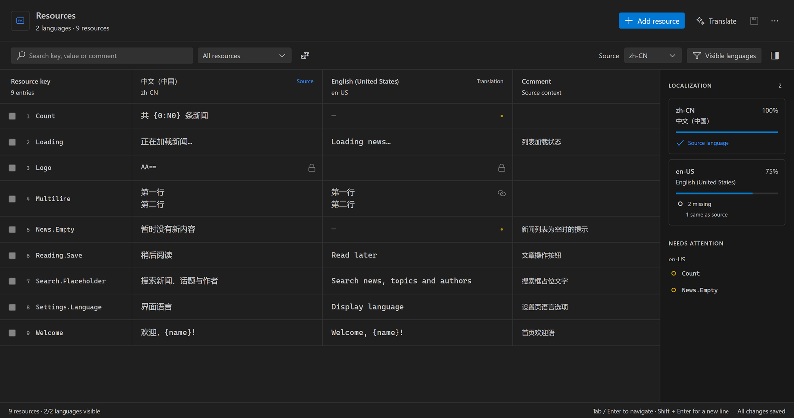

# Rodel Resource Editor

[English](#english) · [简体中文](#简体中文)

## English

A visual `.resw` / `.resx` editor for Visual Studio Code. Edit resource tables, manage translations side by side, and review Copilot suggestions without leaving your editor.

Version **0.0.1** · VS Code **1.95+** · Publisher **云之幻 (RichasyZhang)**

### Resource editing



- Edit **Key, Value and Comment**, including multiline text; add, duplicate, rename or delete resources across languages.
- Keep keys pinned while scrolling language columns. Search, sort and filter missing, identical or read-only values.
- Choose visible languages; the source stays visible. The sidebar shows completion and locates missing translations.
- Navigate with Tab / Shift+Tab and Enter, insert newlines with Shift+Enter, and discard cell drafts with Escape. New resources are highlighted and scrolled into view.
- Use VS Code theme colors, editor fonts and Codicons, including light, dark, high-contrast and custom themes.


### Copilot translation and editable review


Translate selected keys or all missing values into chosen languages through **GitHub Copilot and the official VS Code Language Model API**. Requests include source text, key, comment and an optional glossary. Existing non-empty translations are preserved.

Default batches contain up to 20 resources, with three concurrent requests and no total translation-count limit. Completed batches appear as they finish. Cancelling stops new batches, signals in-flight requests and retains completed, validated results.

Filter review by language, search source text and suggestions, edit translations directly, and choose which changes to apply. Manual corrections are checked again for placeholders, formatting tokens, markup, exact line breaks and XML characters. Filtering changes the view, while all checked changes are applied. Accepted edits support undo/redo.

VS Code handles Copilot consent. No translation-service API key is required; basic editing works without Copilot. Sent requests may consume usage even when later cancelled.

### Files, Excel and saving

- Discover `Strings/<language>/<name>.resw` and `<name>.resx` / `<name>.<culture>.resx`. Resource names and projects stay separate, including multi-root workspaces.
- Create language files using BCP-47 codes from folder/project/resource context menus. No implicit English file is created. Explicit defaults are respected; optional Sprout detection reads project settings.
- Export/import Excel with **Key, Comment and language columns**, validating and reviewing imports before applying.
- Patch target resource nodes while preserving untouched XML, comments, headers, `xml:space`, formatting and non-text resources. VS Code owns encoding, BOM, dirty state and saving.
- Share documents across views; reject stale edits and previews. Open XML for native Git diffs and save-conflict resolution. Invalid XML, duplicate keys and merge markers block unsafe editing; unsupported types remain read-only.
- Optionally generate string-only `.resx` `Designer.cs` files; disabled by default. `.resw` accessors remain the responsibility of Sprout or your own generator.

### Get started

1. Install from Marketplace, or use **Extensions → … → Install from VSIX** with `artifacts/rodel-resource-editor-0.0.1.vsix`.
2. Right-click a resource and choose **Open Resource Editor**, or run **Rodel: Open Resource Editor**.
3. Choose source/visible languages, edit cells, then **Save all**. The editor is optional by default; use **Reopen Editor With** to make it the default.

```json
{
  "rodelResx.defaultLanguage": "zh-CN",
  "rodelResx.translationBatchSize": 20,
  "rodelResx.translationConcurrency": 3,
  "rodelResx.glossary": { "阅读器": "reader" }
}
```

Independent examples live in `samples/Strings`, `samples/LongText/Strings` and `samples/Copilot/Strings`. Natural-language grammar checking is planned; XML validation is available. Designer generation requires supported C# identifiers and the correct assembly resource base name.

## 简体中文

融入 VS Code 的 `.resw` / `.resx` 可视化资源编辑器。在表格中编辑资源、多语言并排管理，并直接预览和修改 Copilot 的翻译建议。

版本 **0.0.1** · VS Code **1.95+** · 发布者 **云之幻（RichasyZhang）**

### 资源编辑


- 编辑 **Key、Value 和 Comment**，支持多行文本；跨语言添加、复制、改名和删除资源。
- 固定 Key 列，语言列横向滚动；搜索、排序及缺失、与源值相同、只读项筛选。
- 自选显示语言，源语言始终保留；侧栏显示完成度，点击缺失项定位。
- Tab / Shift+Tab 和 Enter 导航，Shift+Enter 换行，Escape 放弃单元格草稿；新增资源自动高亮并滚动定位。
- 使用 VS Code 主题颜色、编辑器字体和 Codicons，适配浅色、深色、高对比度及自定义主题。

### Copilot 翻译与可编辑预览

通过官方 VS Code Language Model API 使用可用的 **GitHub Copilot 模型**，翻译选中键或指定语言的全部缺失项。请求携带源文、Key、Comment 和可选术语表，保留已有非空译文。

默认每批最多 20 项，同时请求 3 个批次，没有翻译总量上限。已完成批次实时追加到预览；取消停止新批次、向进行中的请求发送取消信号，并保留已完成且校验通过的结果。


预览可按语言筛选，搜索源文、注释和译文，直接编辑多行翻译，并勾选要应用的项。修改后再次校验占位符、格式符、标记、精确换行和 XML 字符。筛选只改变显示范围；应用所有语言中已勾选的更改，支持撤销/重做。

授权由 VS Code 处理，无须额外翻译服务 API Key。Copilot 不可用时基础编辑仍可使用。已发出的请求可能产生用量，即使随后取消。

### 文件、Excel 与保存

- 适配 `Strings/<language>/<name>.resw` 和 `<name>.resx` / `<name>.<culture>.resx`；按资源名与项目隔离，支持多项目工作区。
- 右键目录、项目或资源添加语言文件，输入 BCP-47 代码。不隐含创建英文资源，保留明确的默认语言；可选读取 Sprout 项目设置。
- Excel 往返包含 **Key、Comment 和各语言列**；导入先校验，再预览和确认。
- 使用文本范围补丁，保留未修改的 XML、注释、头部、`xml:space`、格式与非文本资源。编码、BOM、未保存状态和保存由 VS Code 管理。
- 多编辑器共享文档，阻止过时编辑和预览；Git 比较、保存冲突可切换原生 XML 视图。损坏 XML、重复键及合并标记阻止不安全编辑；不支持的资源类型保持只读。
- 可选生成字符串 `.resx` 的 `Designer.cs`，默认关闭；`.resw` 类型访问器继续由 Sprout 或现有生成器负责。

### 开始使用

1. 从 Marketplace 安装，或通过 **扩展 → … → 从 VSIX 安装** 选择 `artifacts/rodel-resource-editor-0.0.1.vsix`。
2. 右键资源选择 **Open Resource Editor**，或运行 **Rodel: Open Resource Editor**。
3. 选择源语言和显示语言，编辑后点击 **Save all**。默认不抢占 XML 编辑器，可通过 **Reopen Editor With** 设为默认。

独立样本位于 `samples/Strings`、`samples/LongText/Strings` 和 `samples/Copilot/Strings`。配置示例见上方 JSON；[详细中文说明](docs/USAGE.zh-CN.md)。自然语言语法检查属于后续功能，XML 校验已可用。Designer 仅支持字符串与合格的 C# 标识符，并需配置准确的程序集资源基名。

## Development / 开发

```powershell
npm ci
npm run check
npm test
npm run test:ui
npm run test:host
npm run test:designer
npm run package
```

F5 launches an independent Extension Development Host. Default tests do not call paid models. `npm run test:copilot:live` is an explicit opt-in test using copied samples and the official consent flow. Screenshots capture the actual extension webview rendered with independent samples; no real project resources were modified.

F5 启动独立开发窗口。默认测试不请求真实模型；`npm run test:copilot:live` 是显式联调入口，使用样本副本并遵循官方授权。截图来自扩展真实 Webview 与独立样本，没有修改真实项目资源。

[Implementation status / 实现状态](docs/STATUS.md) · [Publishing / 发布说明](docs/PUBLISHING.md) · [MIT License](LICENSE)
