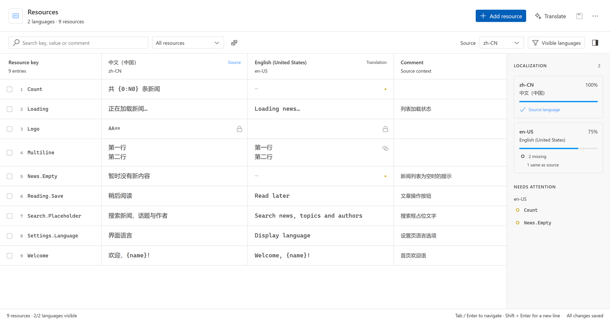
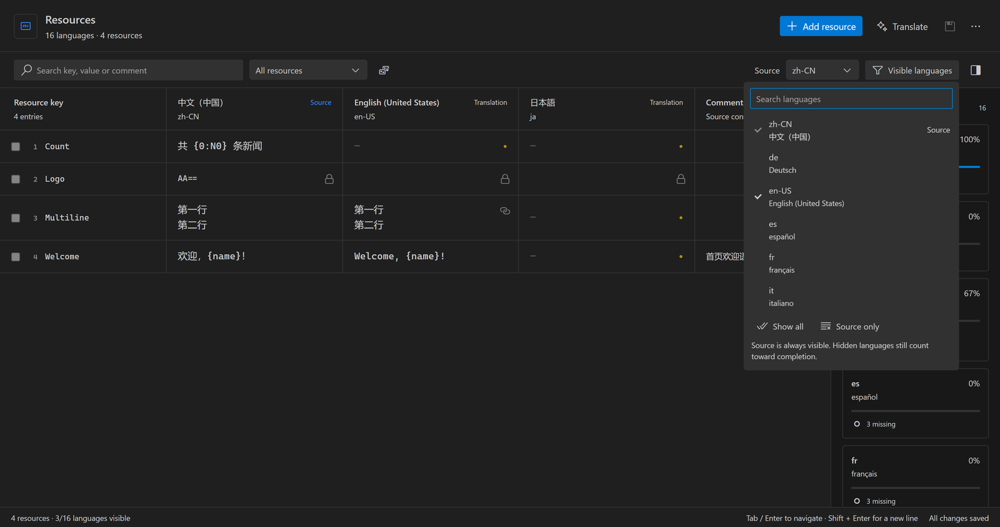
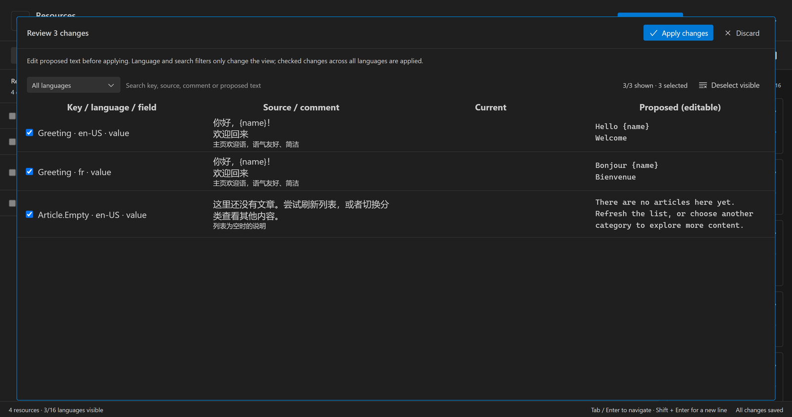

# Rodel Resource Editor

[English](README.md)

融入 VS Code 的 `.resw` / `.resx` 可视化资源编辑器。在表格中编辑资源、多语言并排管理，并直接预览和修改 Copilot 的翻译建议。

版本 **0.0.2** · VS Code **1.95+** · 发布者 **云之幻（RichasyZhang）**

### 资源编辑



- 编辑 **Key、Value 和 Comment**，支持多行文本；跨语言添加、复制、改名和删除资源。
- 固定 Key 列，语言列横向滚动；搜索、排序及缺失、与源值相同、只读项筛选。
- 自选显示语言，源语言始终保留；侧栏显示完成度，点击缺失项定位。
- Tab / Shift+Tab 和 Enter 导航，Shift+Enter 换行，Escape 放弃单元格草稿；新增资源自动高亮并滚动定位。
- 使用 VS Code 主题颜色、编辑器字体和 Codicons，适配浅色、深色、高对比度及自定义主题。



### Copilot 翻译与可编辑预览

通过官方 VS Code Language Model API 使用可用的 **GitHub Copilot 模型**，翻译选中键或指定语言的全部缺失项。请求携带源文、Key、Comment 和可选术语表，保留已有非空译文。

默认每批最多 20 项，同时请求 3 个批次，没有翻译总量上限。已完成批次实时追加到预览；取消停止新批次、向进行中的请求发送取消信号，并保留已完成且校验通过的结果。



预览可按语言筛选，搜索源文、注释和译文，直接编辑多行翻译，并勾选要应用的项。修改后再次校验占位符、格式符、标记、精确换行和 XML 字符。筛选只改变显示范围；应用所有语言中已勾选的更改，支持撤销/重做。

授权由 VS Code 处理，无须额外翻译服务 API Key。Copilot 不可用时基础编辑仍可使用。已发出的请求可能产生用量，即使随后取消。

### 文件、Excel 与保存

- 适配 `Strings/<language>/<name>.resw` 和 `<name>.resx` / `<name>.<culture>.resx`；按资源名与项目隔离，支持多项目工作区。
- 右键目录、项目或资源添加语言文件，输入 BCP-47 代码。不隐含创建英文资源，保留明确的默认语言；可选读取 Sprout 项目设置。
- Excel 往返包含 **Key、Comment 和各语言列**；导入先校验，再预览和确认。
- 使用文本范围补丁，保留未修改的 XML、注释、头部、`xml:space`、格式与非文本资源。编码、BOM、未保存状态和保存由 VS Code 管理。
- 多编辑器共享文档，阻止过时编辑和预览；Git 比较、保存冲突可切换原生 XML 视图。损坏 XML、重复键及合并标记阻止不安全编辑；不支持的资源类型保持只读。
- 可选生成字符串 `.resx` 的 `Designer.cs`，默认关闭；`.resw` 类型访问器继续由 Sprout 或现有生成器负责。

### 开始使用

1. 从 Marketplace 安装，或通过 **扩展 → … → 从 VSIX 安装** 选择 `artifacts/rodel-resource-editor-0.0.2.vsix`。
2. 右键资源选择 **Open Resource Editor**，或运行 **Rodel: Open Resource Editor**。
3. 选择源语言和显示语言，编辑后点击 **Save all**。默认不抢占 XML 编辑器，可通过 **Reopen Editor With** 设为默认。

独立样本位于 `samples/Strings`、`samples/LongText/Strings` 和 `samples/Copilot/Strings`。[详细中文说明](docs/USAGE.zh-CN.md)。自然语言语法检查属于后续功能，XML 校验已可用。Designer 仅支持字符串与合格的 C# 标识符，并需配置准确的程序集资源基名。


### 配置示例

```json
{
  "rodelResx.defaultLanguage": "zh-CN",
  "rodelResx.translationBatchSize": 20,
  "rodelResx.translationConcurrency": 3,
  "rodelResx.glossary": { "阅读器": "reader" }
}
```

## 开发

```powershell
npm ci
npm run check
npm test
npm run test:ui
npm run test:host
npm run test:designer
npm run package
```

F5 启动独立开发窗口。默认测试不请求真实模型；`npm run test:copilot:live` 是显式联调入口，使用样本副本并遵循官方授权。截图来自扩展真实 Webview 与独立样本，没有修改真实项目资源。

[实现状态](docs/STATUS.md) · [发布说明](docs/PUBLISHING.md) · [MIT 许可证](LICENSE)
